# USB ký số nào dùng được với MacSigner?

Cập nhật ngày **21/10/2026**.

> [!IMPORTANT]
> **Câu trả lời ngắn:** hiện tại **chưa có USB ký số nào** được xác nhận ký được bằng MacSigner.
>
> MacSigner đang ở giai đoạn thử nghiệm (Alpha). Với USB của **CA2** và **E-CA**, MacSigner đã đọc được chứng thư bên trong trên **Windows**, nhưng chưa ký thử. Chưa xác nhận đọc được hai dòng USB này trên **macOS, gồm Mac M2**. Nhận đầu đọc USB không đồng nghĩa đọc được chứng thư. Các hãng khác còn chưa được thử với USB thật.
>
> Nếu đã có **chữ ký số dạng tệp** hợp lệ (`.p12` hoặc `.pfx`), bạn có thể dùng luồng nhập tệp. Không mặc định khóa trong USB xuất được thành tệp; không gửi khóa bí mật hoặc PIN qua chat.

## Tra cứu theo nhà cung cấp

Tìm tên đơn vị đã bán USB ký số cho bạn (in trên USB hoặc trên hợp đồng). Danh sách gồm 26 nhà cung cấp chữ ký số công cộng tại Việt Nam, theo [Vietnam RootCA](https://rootca.gov.vn/).

**Cách đọc cột "Hiện trạng":**

- 🟢 **Đã đọc trên Windows:** đã đọc chứng thư trên USB thật bằng bộ kết nối của máy thử; không khẳng định máy chưa từng cài thành phần hãng, không áp dụng mặc nhiên cho macOS hoặc mọi đời USB.
- 🟡 **Chưa test full:** đã có một số bộ kết nối để phân tích hoặc thử khởi tạo; chưa đủ bằng chứng đọc/ký trên USB thật, chưa mặc nhiên được đóng gói vào app.
- ⚪ **Chưa có bộ đọc USB:** chưa có đường đọc USB được xác nhận; có thể đã có tài liệu hoặc phần mềm ký từ xa.

| Logo | Nhà cung cấp | Hiện trạng | Ghi chú |
| --- | --- | --- | --- |
|  | BkavCA | 🟡 Chưa test full | Hãng có nhiều đời USB, cần thử từng đời |
| 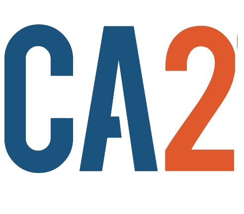 | CA2 / Nacencomm | 🟢 Đã đọc trên Windows | Đã đọc được 2 chứng thư trên USB CA2 ACE; macOS/M2 chưa xác nhận |
| 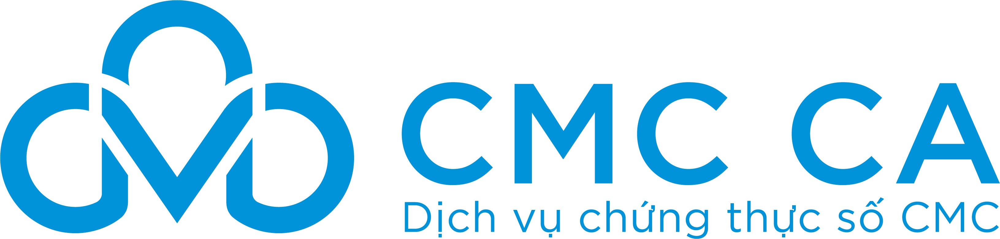 | CMC-CA | 🟡 Chưa test full | |
| 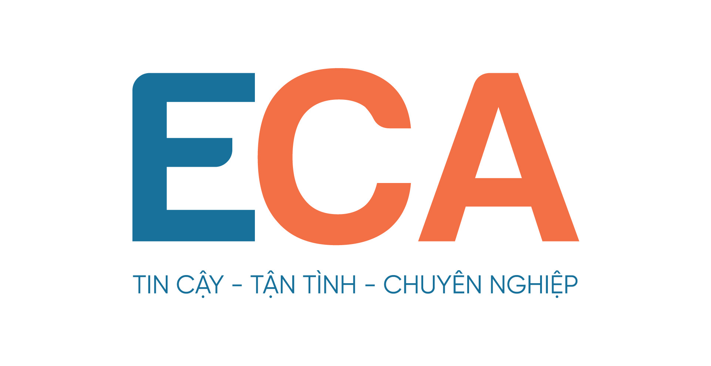 | E-CA (Thái Sơn) | 🟢 Đã đọc trên Windows | Đã đọc được 1 chứng thư; macOS/M2 chưa xác nhận |
|  | EASYCA | 🟡 Chưa test full | |
| 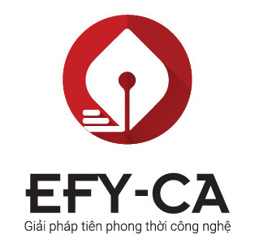 | EFY-CA | 🟡 Chưa test full | |
|  | FASTCA | 🟡 Chưa test full | Có một số đời USB; hai thành phần có nghi vấn toàn vẹn bị chặn chạy |
| 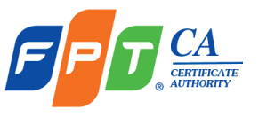 | FPT-CA | 🟡 Chưa test full | Chưa đủ cho mọi đời USB; một số gói còn chờ đối chiếu nguồn |
|  | Hilo-CA | 🟡 Chưa test full | Chưa đủ cho mọi đời USB |
| 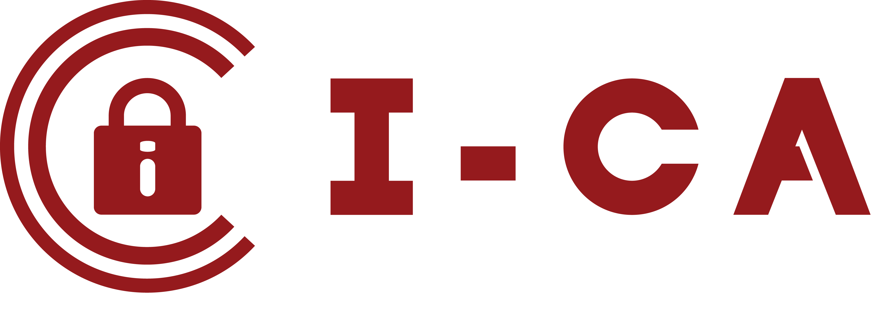 | I-CA | 🟡 Chưa test full | |
| 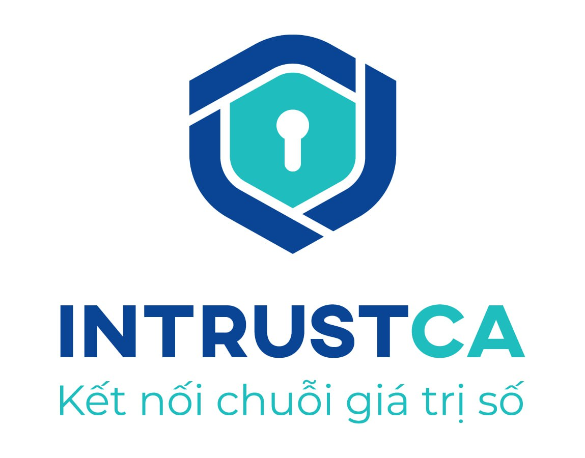 | IntrustCA | ⚪ Chưa có bộ đọc USB | Thành phần đã phân tích là cầu nối ký từ xa, chưa xác nhận đường USB |
| 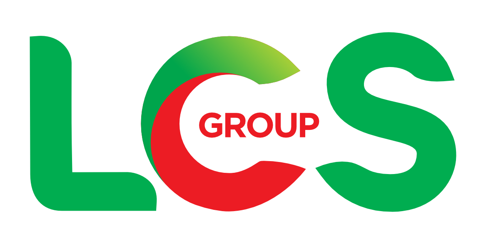 | LCS-CA | 🟡 Chưa test full | Có cho USB đời V2 |
| 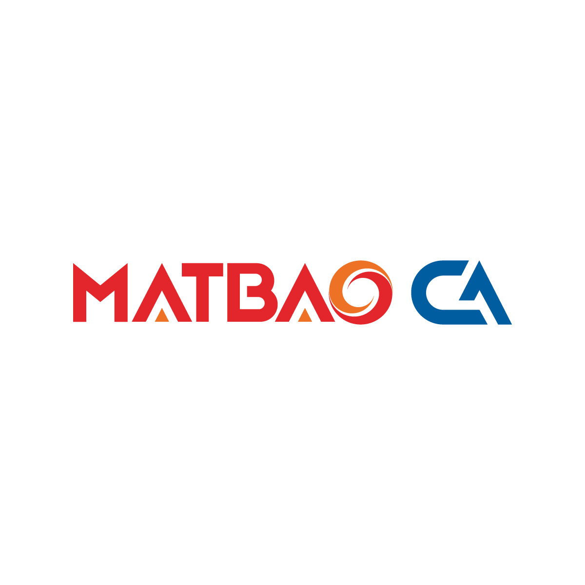 | MATBAO-CA | ⚪ Chưa có bộ đọc USB | |
| 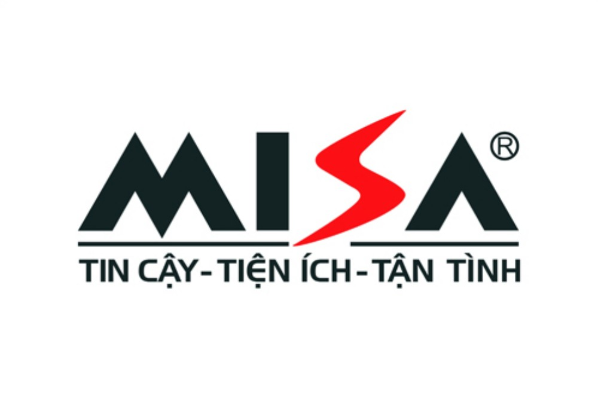 | MISA-CA | 🟡 Chưa test full | Bộ kết nối khởi tạo được trên máy thử, chưa thử USB MISA thật |
|  | MK CA | ⚪ Chưa có bộ đọc USB | |
|  | MOBIFONE CA | 🟡 Chưa test full | Đã có gói từ liên kết trong tài liệu hãng; hai bộ kết nối khởi tạo được, chưa có USB thật |
| 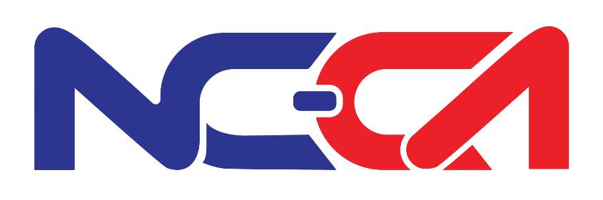 | NC-CA | 🟡 Chưa test full | |
|  | Newtel-CA | 🟡 Chưa test full | Có cho USB đời V6 |
| 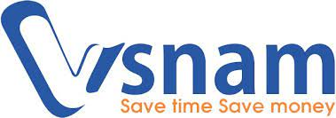 | ONE-CA | 🟡 Chưa test full | |
| 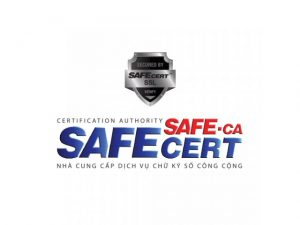 | Safe-CA | 🟡 Chưa test full | Có cho USB đời V1, V2 |
|  | SmartSign / Vina-CA | 🟡 Chưa test full | Có cho USB đời V6 |
| 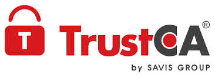 | TrustCA | 🟡 Chưa test full | Chưa đủ cho mọi đời USB |
| 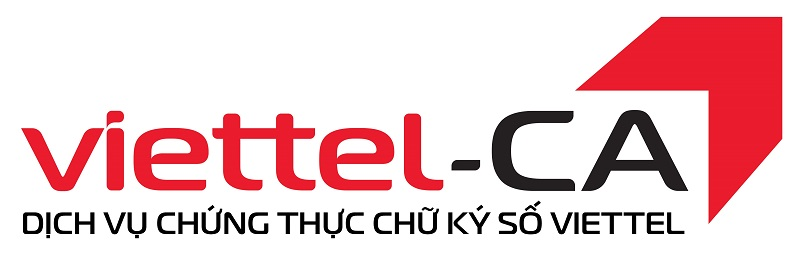 | Viettel-CA | 🟡 Chưa test full | Một số bộ kết nối đời V0–V5 khởi tạo được; không xác nhận ký trên USB thật |
| 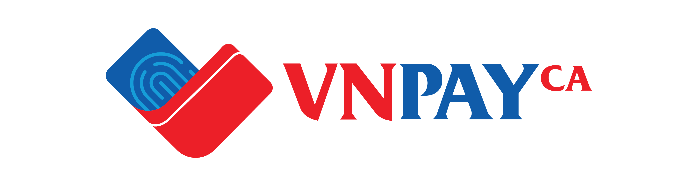 | VNPAY-CA | ⚪ Chưa có bộ đọc USB | Đã phân tích phần mềm ký, chưa có bộ kết nối USB độc lập |
| 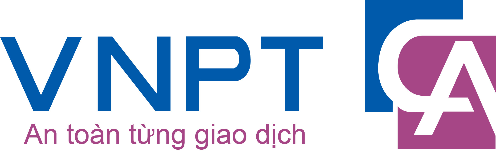 | VNPT-CA | 🟡 Chưa test full | Đã thấy bộ kết nối Mac có Intel và ARM64 khi phân tích tĩnh; chưa chạy thử trên Mac |
|  | WINCA | 🟡 Chưa test full | Lấy từ đại lý, chưa đối chiếu với hãng |

Bảng này chỉ nói về **USB ký số**. Thẻ ký số (smart card), SIM ký số và ký từ xa qua điện thoại là những loại khác, chưa được xét ở đây.

## USB của tôi không thuộc nhóm 🟢, tôi làm gì?

1. **Đã có tệp ký hợp lệ:** nhập ở mục **Chứng thư số → Nhập P12/PFX**. Đây là luồng riêng, không phải cách chuyển mọi USB thành tệp ký.
2. **Muốn thử USB:** cần bản MacSigner có bộ đọc tương thích đi kèm. Hiện bản thử đóng gói E-CA/CA2 chỉ dành cho Windows; không áp dụng cho Mac M2. Biểu tượng đầu đọc USB không chứng minh đã đọc được chứng thư.
3. **Giúp dự án:** báo kết quả bạn thử được theo hướng dẫn ở [cuối trang](#bạn-có-usb-ký-số-và-muốn-giúp).

## MacSigner làm gì và không làm gì với USB của bạn

**Có làm:**

- Nhận biết USB khi bạn cắm vào.
- Đọc chữ ký số trong USB để bạn chọn. Bước này không cần PIN.
- Hỏi PIN khi bạn bấm ký. PIN do bạn nhập, và chỉ dùng cho lần ký đó.
- Báo khi chữ ký số sắp hết hạn.

**Không bao giờ làm:**

- **Tự thử PIN** hoặc dùng PIN mặc định. Nhập sai PIN nhiều lần có thể **khóa USB**, nên MacSigner không bao giờ tự nhập lại PIN.
- **Đổi PIN hoặc mở khóa USB.** Việc này bạn làm bằng phần mềm của hãng.
- **Gia hạn hoặc cấp lại chữ ký số.** Chỉ nhà cung cấp mới làm được.
- **Xóa hay ghi đè bất cứ thứ gì trên USB.**

## Câu hỏi thường gặp

**Có cần cài thêm phần mềm gì không?**
Mục tiêu là MacSigner có sẵn bộ đọc, không bắt bạn cài trình quản lý token riêng. Bản build thử Windows ngày 21/10/2026 đã đóng gói bộ kết nối E-CA/CA2 ACE và worker phù hợp; hai bộ kết nối khởi tạo được nhưng lần thử gói mới không thấy token, chưa test full ký hoặc máy sạch. Bản macOS/M2 chưa có bộ đọc độc lập hoàn chỉnh cho hai dòng này. Nhãn 🟢 chỉ xác nhận đã đọc chứng thư trên Windows trước đây, không có nghĩa mọi máy cắm vào là dùng. Các hãng khác chưa được tự động đóng gói chỉ vì đã tìm thấy bộ cài. Trình duyệt chuyển yêu cầu sang MacSigner, không tự đọc USB.

**Tôi vừa gia hạn chữ ký số, MacSigner có tự dùng chữ ký mới không?**
Không tự đổi. MacSigner thấy được chữ ký mới trên USB, nhưng bạn là người chọn dùng chữ ký nào. Chữ ký cũ không bị xóa.

**Chữ ký số còn hạn thì chắc chắn còn dùng được?**
Chưa chắc. Chữ ký số còn hạn vẫn có thể đã bị nhà cung cấp thu hồi (ví dụ khi bạn báo mất USB). Hiện MacSigner **chưa kiểm tra** được chữ ký đã bị thu hồi hay chưa.

**MacSigner chạy trên Windows và Linux được không?**
Có, nhưng cũng giống trên Mac: USB ký số của từng hãng vẫn chưa được thử đủ trên từng hệ điều hành.

**Vì sao nhận được USB rồi mà vẫn chưa ghi là "đã hỗ trợ"?**
Vì nhận được USB và ký được là hai chuyện khác nhau. Một loại USB chỉ được ghi là đã hỗ trợ khi đã qua đủ 4 bước dưới đây trên USB thật, với **từng hãng, từng đời USB và từng hệ điều hành**:

1. Nhận đúng USB, kể cả khi rút ra cắm lại hay cắm nhiều USB cùng lúc.
2. Hiện đúng chữ ký số trong USB.
3. Nhập PIN, bấm hủy và báo lỗi đều chạy đúng, không tự thử lại PIN.
4. Ký thử một tài liệu, rồi dùng công cụ khác kiểm tra chữ ký đó hợp lệ.

## Bạn có USB ký số và muốn giúp?

Hãy [mở một Issue](../../issues) và ghi:

- Tên nhà cung cấp và đời USB (thường in trên vỏ USB).
- Máy bạn dùng (Mac chip Intel hay chip Apple, phiên bản macOS; hoặc Windows/Linux).
- Kết quả: MacSigner có nhận được USB không, có thấy chữ ký số không, ký có được không. Nếu có báo lỗi, chụp màn hình lỗi.

**Tuyệt đối không gửi PIN** hay bất kỳ tệp chữ ký số nào.

---

## Dành cho contributor

**21/26** nhà cung cấp đã được implement: MacSigner tự tìm và nạp thư viện PKCS#11 của hãng (ít nhất một phiên bản), danh sách nằm trong [`src/token/data/token-modules.json`](src/token/data/token-modules.json). Mỗi hãng có nhiều đời USB, nên con số này không phải tỷ lệ thiết bị đã chạy được. Trạng thái chỉ đúng cho những phiên bản phần mềm và thiết bị đã thử.

| Hạng mục | Trạng thái |
| --- | --- |
| Dò đầu đọc và token qua PKCS#11 | Đã có |
| Đọc chứng thư không cần đăng nhập | Đã thử với CA2 ACE và E-CA; một số token buộc đăng nhập trước |
| Đăng nhập PIN trong ứng dụng | Đã có, chưa thử với mọi CA |
| Hộp thoại PIN của Windows | Đã tích hợp; phụ thuộc middleware của hãng |
| Module PKCS#11 32-bit với ứng dụng 64-bit | Đã có tiến trình trung gian x86; đã đọc được CA2 ACE và E-CA, chưa ký bằng PIN |
| Ký RSA PKCS#1 v1.5 với SHA-1/256/384/512 | Đã có, có kiểm thử phần mềm (SoftHSM); chưa thử trên token thật |
| ECDSA, RSA-PSS | Chưa có |
| Phát hiện chứng thư thêm/bớt sau gia hạn | Đã có trong thư viện, chưa nối vào giao diện |
| Cảnh báo sắp hết hạn | Đã có; chưa có nhắc lịch chạy nền |
| Gói CA gốc/trung gian mới | Chỉ chấp nhận theo danh sách đã duyệt; chưa tự tải hay cài vào kho tin cậy |
| Kiểm tra chuỗi tin cậy và thu hồi (CRL/OCSP) | Chưa hoàn chỉnh |
| Gia hạn, cấp lại qua CA | Chưa có; cần kết nối chính thức và phê duyệt của từng CA |
| Đổi/mở khóa PIN, ghi chứng thư, xóa khóa | Không làm; không thay đổi dữ liệu trên token |
| Nhiều yêu cầu ký đồng thời | Chưa bảo đảm; cần điều phối phiên, cô lập lỗi và đo tải |

Máy thử nghiệm hiện đã cài middleware CA2, nên chưa thể kết luận một máy sạch cũng chạy được. Kiểm thử phần mềm đạt không thay thế kiểm thử trên thiết bị thật. Chỉ nâng trạng thái trong tài liệu này khi Pull Request có kèm ảnh chụp chứng minh đã thử.

## Chi tiết khảo sát và kiểm chứng kỹ thuật

Khởi tạo được chỉ xác nhận bộ kết nối chạy và liệt kê thiết bị không báo lỗi trên máy thử; không xác nhận đọc được chứng thư hoặc ký thành công trên USB của hãng đó.

### Nhà cung cấp

Danh sách nền gồm 26 CA công cộng trên [Vietnam RootCA](https://rootca.gov.vn/) tại thời điểm khảo sát.

| Logo | Nhà cung cấp | Gói đã thu thập | Đọc USB thật | Ghi chú |
| --- | --- | --- | --- | --- |
| | BkavCA | Có | Chưa test full | Khởi tạo được 8 thành phần Windows 32/64-bit; chưa thử ký trên các đời USB |
| | FPT-CA | Có ứng dụng đi kèm và gói V3/V4 từ nguồn phân phối | Chưa test full | Xác nhận tĩnh 4 bộ kết nối Windows 32/64-bit; bộ cài có chữ ký hợp lệ trên máy kiểm tra nhưng nguồn phân phối chưa được hãng xác nhận; chưa chạy bộ kết nối hoặc ký thật |
| | Viettel-CA | Có bộ cài V0, V2–V5; gói sửa V1/V2 và bản cập nhật V6 | Chưa test full | Khởi tạo được bản 32/64-bit V0, V2–V5 trên máy hiện tại; gói sửa V1 còn lỗi khởi tạo; chưa thử ký trên từng đời USB |
| | VNPT-CA | Có 7 gói Windows/macOS: eToken, Cyken, V8 và bản Token Manager mới | Chưa test full | Khởi tạo được 10 thành phần Windows 32/64-bit; xác nhận tĩnh thư viện macOS Intel/ARM; chưa thử ký trên USB VNPT và máy Mac |
| | CA2 / Nacencomm | Có ba bộ | Đã đọc CA2 ACE, hai chứng thư, không PIN | Khởi tạo được 6/8 thành phần; đã sửa bộ phụ thuộc 64-bit đời đỏ/xanh; 2 thành phần đời cũ còn lỗi khởi tạo; chưa ký thật |
| | Safe-CA | Có V1 và V2 | Chưa test full | Khởi tạo được 4 thành phần Windows 32/64-bit; chưa thử ký trên USB Safe-CA |
| | SmartSign / Vina-CA | Có V6 | Chưa test full | Khởi tạo được bản Windows 64-bit; chưa thử ký trên USB |
| | Newtel-CA | Có V6 | Chưa test full | Khởi tạo được bản Windows 32-bit; chưa thử ký trên USB |
| | EFY-CA | Có | Chưa test full | Khởi tạo được bản Windows 32-bit; chưa thử ký trên USB |
| | TrustCA | Có bộ cài V1 từ máy chủ hãng | Chưa test full | Khởi tạo được 2 bộ kết nối Windows 32/64-bit, chưa thấy USB tương ứng; chưa đọc chứng thư hoặc ký thật |
| | MISA-CA | Có | Chưa test full | Thành phần x86 khởi tạo được, chưa xác nhận với USB MISA |
| | NC-CA | Có | Chưa test full | Khởi tạo được bản Windows 32-bit; chưa thử ký trên USB |
| | LCS-CA | Có V2 | Chưa test full | Khởi tạo được bản Windows 32-bit; chưa thử ký trên USB |
| | CMC-CA | Có | Chưa test full | Khởi tạo được bản Windows 32-bit; chưa thử ký trên USB hoặc hệ điều hành khác |
| | EASYCA | Có | Chưa test full | Khởi tạo được bản Windows 32-bit; chưa thử ký trên USB |
| | FASTCA | Có V4, V5.1, V6, V9 và Fast V1 | Chưa test full | Khởi tạo được 8 thành phần Windows 32/64-bit; gói cũ mang tên NewCA; Fast V1 chỉ khảo sát tĩnh do chưa khớp mã kiểm tra công bố; chưa thử ký trên từng đời USB |
| | I-CA | Có | Chưa test full | Khởi tạo được bản Windows 32-bit; chưa thử ký trên USB |
| | Hilo-CA | Có bộ cài V1 từ máy chủ hãng | Chưa test full | Khởi tạo được 2 bộ kết nối Windows 32/64-bit, chưa thấy USB tương ứng; chưa đọc chứng thư hoặc ký thật |
| | ONE-CA | Có | Chưa test full | Khởi tạo được 2 thành phần Windows 32/64-bit; chưa thử ký trên USB |
| | WINCA | Có từ nhà phân phối | Chưa test full | Cần đối chiếu nguồn với CA |
| | MATBAO-CA | Chưa có | Chưa test full | Cần bộ kết nối và thiết bị thử |
| | E-CA | Có | Đã đọc một chứng thư, không PIN | Xác nhận CA phát hành E-CA/THAISONSOFT; adapter 32-bit đã nối trong mã nguồn, cần chạy bản ứng dụng cập nhật và kiểm chứng ký thật |
| | MOBIFONE CA | Có bộ cài offline V1 theo hướng dẫn chính hãng | Chưa test full | Khởi tạo được 2 bộ kết nối Windows 32/64-bit; chưa thấy USB tương ứng, chưa đọc chứng thư hoặc ký thật |
| | VNPAY-CA | Có VNPAY Signer bản 01/04/2026 và tài liệu tích hợp ký từ xa | Chưa test full | Gói ứng dụng lấy từ mục tải công khai của hãng, khớp mã kiểm tra công bố; chưa xác nhận bộ kết nối USB độc lập, chưa chạy hoặc ký thật |
| | IntrustCA | Có Token Manager VCSP v1.1.4 từ mục phần mềm chính hãng | Chưa test full | Khớp SHA-256 công bố; có giao diện kết nối 32/64-bit cho token ảo. Chưa chạy bộ cài, chưa kết nối tài khoản; không coi đây là USB vật lý đã hỗ trợ |
| | MK CA | Chưa có bộ kết nối USB | Chưa test full | Đã tìm thấy ứng dụng MK SmartCA ký từ xa trên kho ứng dụng; không dùng ứng dụng này làm bằng chứng hỗ trợ USB MK |

**24/26 nhà cung cấp đã có ít nhất một gói được thu thập. Đây không phải tỷ lệ hỗ trợ thiết bị.** Một số gói mới chỉ phục vụ cập nhật, ứng dụng đi kèm hoặc ký từ xa/token ảo.

Nguồn bổ sung: bộ cài Hilo-CA và TrustCA được lấy từ địa chỉ phân phối tìm thấy trong ứng dụng quản lý của hãng; gói FPT V3/V4 lấy theo [trang phân phối](https://www.fpt-ca.com/2026/04/bo-cai-dat-token-manager-fpt-ca.html), chưa coi là nguồn chính hãng. Không chạy bộ cài hoặc tự cài thành phần vào Windows. Gói khảo sát được lưu riêng, chưa mặc nhiên đưa vào bản phát hành hoặc được phép phân phối lại.

Đối chiếu thêm ngày 20/10/2026: [trang hỗ trợ FPT chính hãng](https://esign.fpt.com/support) có liên kết tải gói token, nhưng địa chỉ đích trả HTTP 404 khi kiểm tra. Vì chưa tải được gói này để so sánh, chưa nâng mức xác nhận nguồn cho các gói FPT V3/V4 đã thu thập. Chưa tìm được bộ kết nối công khai phù hợp của Mắt Bão và MK qua các nguồn đã khảo sát; điều này không có nghĩa hãng không cung cấp bộ cài.

Nguồn MK bổ sung: [mục hướng dẫn MK Hi-Tek](https://mkhitek.com.vn/bai-viet/tong-hop-huong-dan-su-dung-mk-hitek) và [MK SmartCA do MK GROUP công bố trên Google Play](https://play.google.com/store/apps/details?id=vn.mk.mk_sic). Mô tả MK SmartCA là ký từ xa, không cần USB; chưa tải gói ứng dụng hoặc xác nhận giao thức tích hợp. Chứng thư CA cho USB của MK trong tập công bố mang tên `MK CA - OneCA`; không đồng nhất nhà phát hành này với ONE-CA chỉ vì tên gần giống.

Tất cả các nhà cung cấp trong bảng đều **chưa được kiểm chứng đầy đủ việc ký bằng PIN, gia hạn và cấp lại trên USB thật** trong đợt khảo sát này.

Các thiết bị chuyên dùng công vụ, smart card, SIM PKI, HSM và dịch vụ ký từ xa cần ma trận tích hợp riêng. Không tự động tính chúng là USB đã được hỗ trợ.

### Thiết bị chuyên dùng công vụ

Phần này tách riêng, không cộng vào danh sách 26 CA công cộng.

| Đơn vị / dòng thiết bị | Gói đã thu thập | Phạm vi khảo sát | Trạng thái |
| --- | --- | --- | --- |
| VGCA / Bit4ID | Có từ cổng dịch vụ công của đơn vị | Khởi tạo và quét xong với 4 thành phần Windows 32/64-bit trong cấu hình thử đã tắt tùy chọn telemetry, cache chuyển sang thư mục thử; không thấy USB VGCA tương ứng. ARM64 mới khảo sát tĩnh, chưa hỗ trợ chạy Windows ARM | Chưa test full |
| VGCA / TokenManager, SafeNet GCA01 | Có từ cổng dịch vụ công của đơn vị | Giải nén bộ cài và các gói lồng, nhận diện tĩnh thành phần 32/64-bit; gói cũ chưa được chạy hoặc cài vào Windows | Chưa test full |

Nguồn: [cổng dịch vụ công VGCA](https://dichvucong.ca.gov.vn/page/taitainguyen/PM), [hướng dẫn cài đặt MobiFone CA](https://mobica.vn/wp-content/uploads/2024/11/huong-dan-cai-dat-chu-ky-so-bang-token-1.pdf). Khớp mã kiểm tra tải xuống chỉ xác nhận tính toàn vẹn theo thông tin công bố, không thay thế kiểm tra an toàn hoặc thử ký thật.

### Dữ liệu chứng thư CA

Đã thu thập **82 gói chứng thư công bố cho 26 CA công cộng** từ [Vietnam RootCA](https://rootca.gov.vn/), phân tích được **86 chứng thư khác nhau**. Danh sách có cả chứng thư lịch sử, ký từ xa và dấu thời gian; không đồng nghĩa 82 bộ kết nối USB.

- Có 31 chứng thư lịch sử đã hết hạn tại thời điểm khảo sát; không dùng chúng làm bản cập nhật CA đang có hiệu lực.
- Đã đối chiếu chữ ký trực tiếp với chứng thư cấp trên có trong tập khảo sát; thuật toán cũ không được công cụ hỗ trợ được ghi nhận riêng, không tự xem là chữ ký sai.
- Chưa tự phê duyệt chứng thư gốc, chưa cài vào Windows và chưa xác minh đầy đủ đường dẫn tin cậy hoặc trạng thái thu hồi.
- Dữ liệu này phục vụ đối chiếu phiên bản và chuẩn bị cập nhật sau phê duyệt; chưa triển khai cơ chế tự động cập nhật trong ứng dụng.

### Tính năng hỗ trợ

| Tính năng | Trạng thái | Điều kiện và giới hạn |
| --- | --- | --- |
| Tìm đầu đọc và USB | Có trong lõi | Nhận thiết bị không bảo đảm đã có thể ký |
| Tự nhận E-CA / CA2 khi mở ứng dụng hoặc cắm USB | Có trong luồng dò | Tự tìm bộ kết nối có sẵn hoặc đi kèm và dùng worker đúng kiến trúc; không yêu cầu cài ứng dụng quản lý hãng khi bộ kết nối đã dùng được. Chưa đọc được USB không tự kết luận thiếu phần mềm hãng; không tự tải hoặc cài gói chưa được phê duyệt |
| Quét khi cắm nhiều loại USB | Có trong lõi | Tiếp tục quét sau khe bị rút hoặc không được bộ kết nối nhận diện; không biến USB không tương thích thành USB được hỗ trợ; lỗi bộ kết nối nghiêm trọng vẫn được báo |
| Chứng thư trùng serial giữa các USB/CA | Có trong adapter CTSIGN | Giữ riêng chứng thư khác dữ liệu thay vì ghi đè theo serial. Yêu cầu chỉ có serial bị từ chối khi có nhiều chứng thư khác nhau cùng khớp; cần chỉ nạp chứng thư muốn ký, không tự chọn CA hoặc khóa |
| Đọc chứng thư không PIN | Có trong lõi; đã thử CA2 ACE và E-CA | Một số thiết bị có thể yêu cầu đăng nhập trước |
| Nhập PIN trong ứng dụng | Có luồng xử lý | Chưa thử với mọi CA; không tự thử PIN hoặc dùng PIN mặc định |
| Hộp thoại PIN của Windows | Có cơ chế tích hợp | Phụ thuộc thành phần kết nối thiết bị trên máy |
| Ký RSA với SHA-1/256/384/512 | Có trong lõi và có kiểm thử phần mềm | Cần phù hợp thiết bị và chính sách nghiệp vụ; chưa thay thế kiểm thử USB thật |
| Xác minh chữ ký trước khi trả kết quả | Có trong lõi | Luồng ký hàng loạt kiểm tra từng chữ ký, không trả lô có chữ ký sai; đã thử bằng token phần mềm, chưa thử đầy đủ các USB thật |
| Dọn phiên khi ký lỗi | Có trong lõi | Luồng ký digest và ký hàng loạt của lớp USB thử đăng xuất sau lỗi thao tác, không tự thử lại PIN hoặc ký lại; từ chối token báo PIN bị khóa trước đăng nhập |
| ECDSA và RSA-PSS trong luồng USB chung | Chưa triển khai | Chưa công bố hỗ trợ |
| Thiết bị 32-bit với ứng dụng 64-bit | Đã nối trong lõi và adapter ký | Đã đọc CA2 ACE và E-CA; cần thành phần tương thích đi kèm và bản ứng dụng cập nhật; chưa test full ký bằng PIN trên USB thật |
| Nhận chứng thư mới sau gia hạn | Có trong lõi | Nhận biết thêm/bớt chứng thư; chưa nối giao diện hoặc tự đổi lựa chọn ký |
| Cảnh báo sắp hết hạn | Có trong lõi | Chưa có lịch nhắc và thông báo nền hoàn chỉnh |
| Kiểm tra gói CA gốc/trung gian mới | Có bước kiểm tra trong lõi | Chỉ chấp nhận theo danh sách phê duyệt; chưa tự tải hoặc cài vào kho tin cậy |
| Xác minh đầy đủ chuỗi tin cậy và thu hồi | Chưa hoàn chỉnh trong luồng cập nhật mới | Còn hạn không đồng nghĩa đáng tin hoặc chưa bị thu hồi |
| Gia hạn qua nhà cung cấp | Chưa triển khai hoàn chỉnh | Cần kết nối chính thức, hồ sơ/tài khoản và phê duyệt của CA |
| Cấp lại chứng thư | Chưa triển khai hoàn chỉnh | Cần quy trình xác nhận riêng theo nhà cung cấp |
| Đổi hoặc mở khóa PIN | Chưa có luồng quản trị chung | Không tự thực hiện; nhập sai nhiều lần có thể khóa USB |
| Ghi chứng thư hoặc xóa khóa | Chưa có luồng quản trị chung | Không tự thay đổi dữ liệu trên thiết bị |
| Windows | Đang triển khai và kiểm chứng | Phụ thuộc phiên bản OS, kiến trúc và thiết bị |
| macOS / Linux | Chưa xác nhận theo từng CA | Chưa có ma trận kiểm chứng đầy đủ |
| Nhiều yêu cầu ký đồng thời | Chưa bảo đảm thông lượng | Cần hoàn thiện điều phối phiên, cô lập lỗi và đo tải thực tế |

### Giao thức VNPT-CA Plugin trên trình duyệt

Đã khảo sát bản cài cục bộ 1.0.5.3 và [thư viện tích hợp trên website VNPT](https://kyso.vnpt-ca.vn/). Đây là giao thức khác ESIGN và CTSIGN, không chỉ là tên một loại USB.

- Thư viện tích hợp kết nối WebSocket có TLS tới `localhost`, đường dẫn `/plugin`, thử các cổng 4433, 4434, 4435, 9201 và 9202.
- Yêu cầu có `functionID`, `args`, `funcCallback` và `domain`; có các nhóm lấy chứng thư, ký hash, XML, PDF, CMS và chức năng phụ trợ.
- Đã đối chiếu đọc phiên bản với ứng dụng hãng đang chạy: lệnh 11 trả `1.0.5.3*macsignerVersionProbe`, TLS được xác minh bằng kho tin cậy hệ thống, không dùng PIN. Lõi `vnpt::protocol` có bộ đọc yêu cầu và đóng/mở khung phản hồi cùng 6 kiểm thử; chưa phải listener hoặc backend ký VNPT.
- Nhánh kiểm tra nâng cao đối chiếu chữ ký phản hồi bằng khóa công khai được nhà cung cấp chỉ định. Không giả phản hồi thành công, không bỏ bước xác thực và không sử dụng khóa riêng hoặc giấy phép của hãng.
- Chưa có dịch vụ VNPT tương thích hoàn chỉnh trong MacSigner; chưa bật cổng, thay đổi ứng dụng hãng hoặc công bố tương thích website. Cần hoàn thiện TLS và ma trận lệnh trước khi có thể chạy như mô-đun thứ ba song song ESIGN/CTSIGN.
