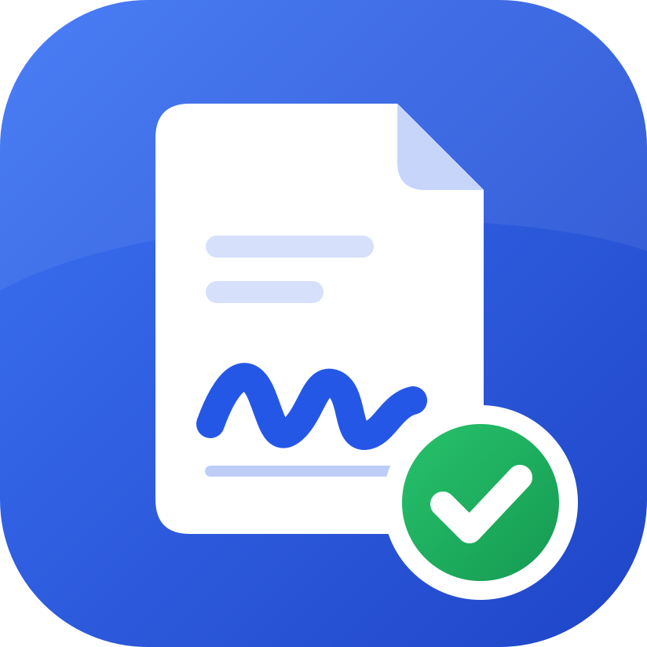
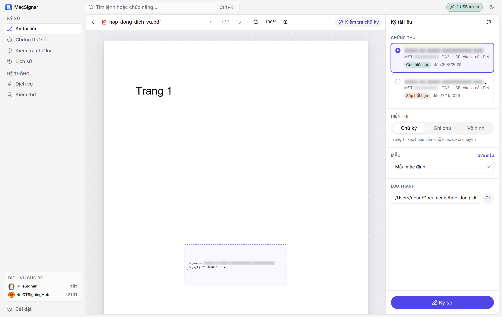
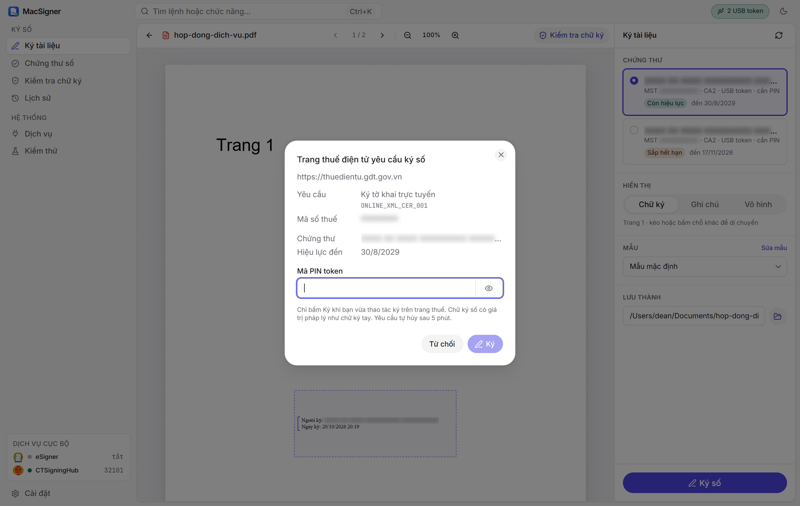
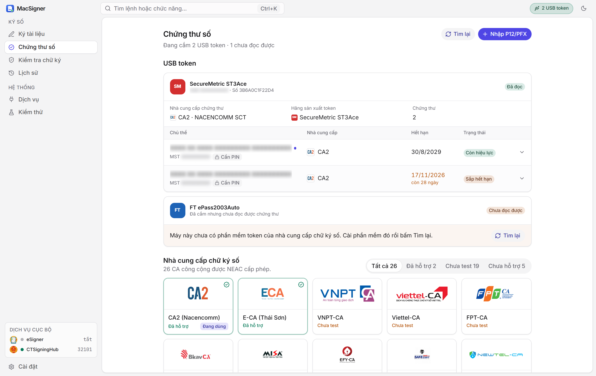
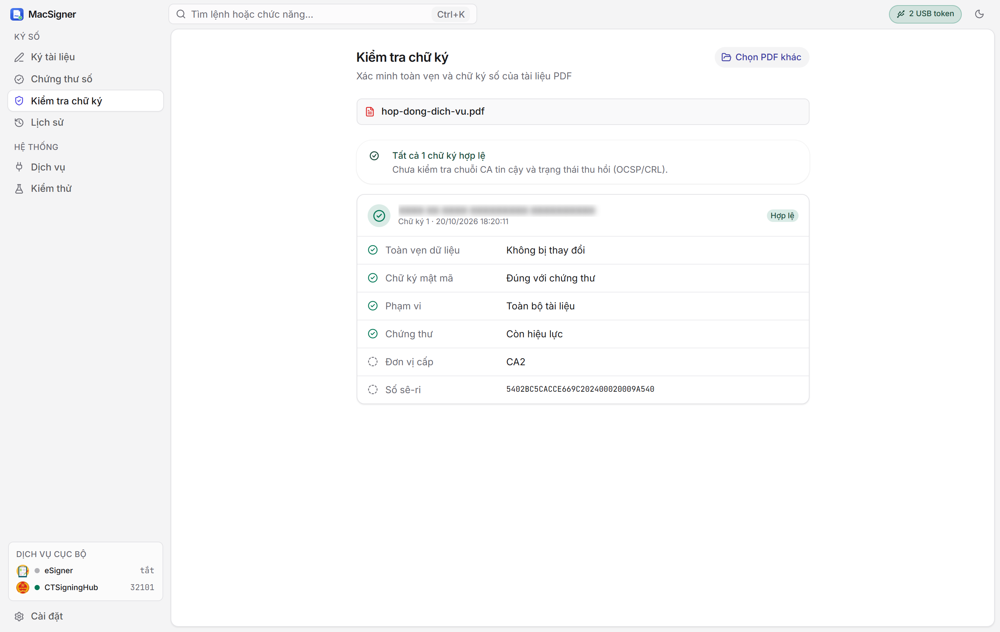
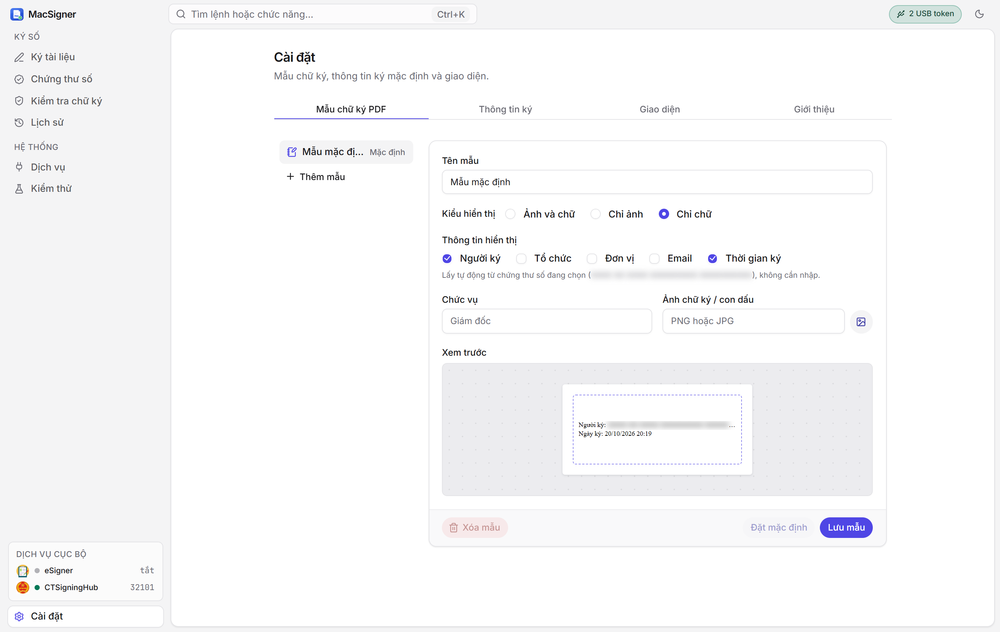
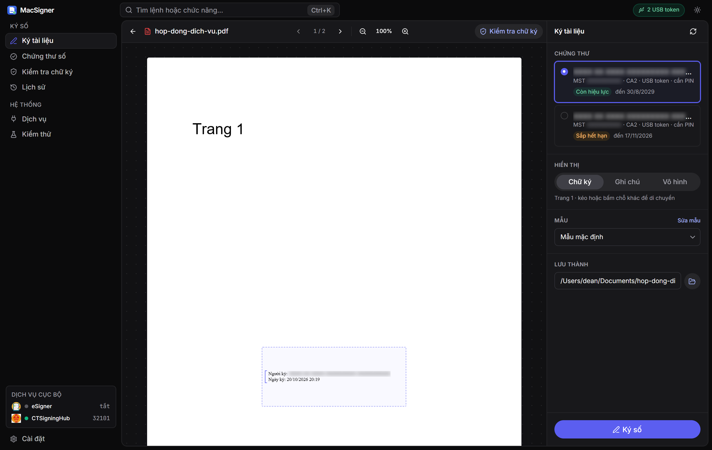
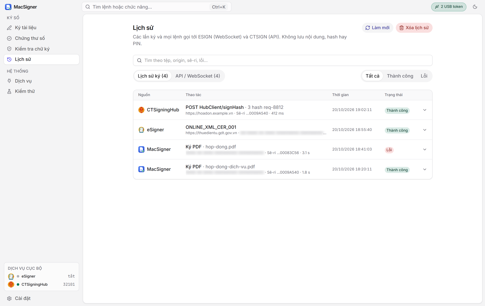
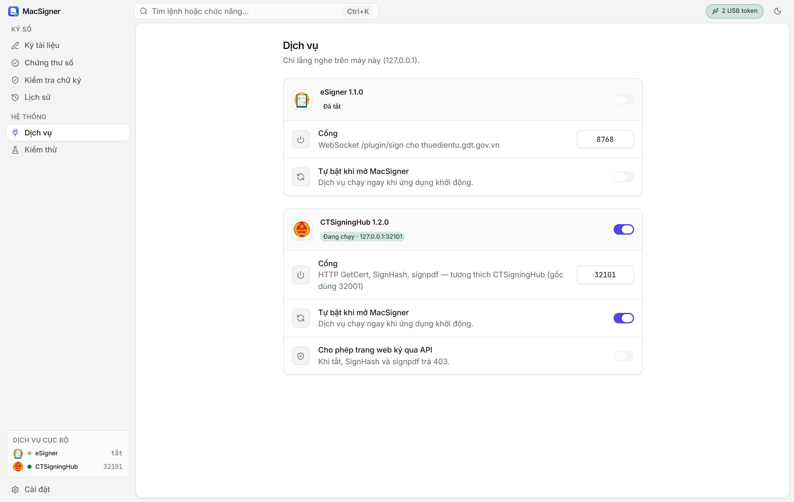

<div align="center">



# MacSigner

**Ký số trên máy Mac cho khai thuế điện tử, dịch vụ công và tài liệu điện tử.**

Những việc trước nay chỉ làm được trên Windows. Không cần mượn máy, không cần máy ảo.

[](#trạng-thái-phát-triển)
[](#cài-đặt-trên-mac)
[](#trên-windows-và-linux)
[](#dành-cho-nhà-phát-triển)
[](LICENSE)

[**Tải về**](../../releases/latest) · [Vì sao có MacSigner](#vì-sao-có-macsigner) · [Thuế và dịch vụ công](#khai-thuế-điện-tử-và-dịch-vụ-công) · [Giao diện](#giao-diện) · [Cài đặt](#cài-đặt-trên-mac) · [Câu hỏi thường gặp](#câu-hỏi-thường-gặp)

<br>



</div>

> [!WARNING]
> **MacSigner đang ở giai đoạn Alpha (đang phát triển).** Hôm nay ứng dụng đã ký và kiểm tra được chữ ký PDF, và đã nhận lệnh ký kê khai thuế trực tuyến từ trang thuế điện tử. Tính năng kê khai trực tuyến mới được kiểm thử với chứng thư thử nghiệm, **chưa được thử trên cổng thuế thật với USB token thật**. Hãy giữ lại công cụ ký hiện có cho các hồ sơ cần nộp đúng hạn. Xem [Trạng thái phát triển](#trạng-thái-phát-triển).

## Vì sao có MacSigner?

Chuyển đổi số đã đưa phần lớn thủ tục với cơ quan nhà nước lên mạng. Doanh nghiệp, hộ kinh doanh và kế toán kê khai, nộp thuế qua cổng thuế điện tử. Người dân và doanh nghiệp nộp hồ sơ trên cổng dịch vụ công. Ở hầu hết các bước đó, **chữ ký số là bắt buộc**.

Thế nhưng từ trước đến nay, ký số cho thuế điện tử và dịch vụ công **gần như chỉ hỗ trợ Windows**:

- Plugin ký mà cổng thuế điện tử yêu cầu cài trên máy chỉ có bản cho Windows.
- Công cụ ký đi kèm USB token của nhà cung cấp chứng thư số cũng làm cho Windows trước. Một số nhà cung cấp đã có bộ kết nối USB token cho macOS, nhưng **phần lớn vẫn chưa hỗ trợ Mac**.
- Hướng dẫn cài đặt của các cổng, các nhà cung cấp hầu như chỉ viết cho Windows.

Kết quả là người dùng Mac, từ kế toán, chủ doanh nghiệp đến người dân, mỗi kỳ khai thuế hay mỗi lần nộp hồ sơ lại phải mượn một máy Windows, cài máy ảo chỉ để dùng một chiếc USB token, hoặc nhờ người khác ký hộ.

**MacSigner ra đời để đưa ký số cho thuế điện tử và dịch vụ công lên máy Mac.** Đây là ứng dụng chạy trực tiếp trên macOS, làm việc thẳng với USB token và đóng vai trò chương trình ký mà các cổng điện tử cần. Chuyển đổi số không nên phụ thuộc vào việc bạn dùng hệ điều hành nào.

## Khai thuế điện tử và dịch vụ công

Đây là mục tiêu chính của MacSigner. Vì dự án đang ở giai đoạn Alpha, bảng dưới đây nói rõ việc nào đã làm được và việc nào đang làm:

| Nhu cầu | Trên Mac với MacSigner |
|---|---|
| Ký số tệp PDF: hợp đồng, công văn, tài liệu đính kèm hồ sơ | **Dùng được ngay** |
| Kiểm tra chữ ký số trên tệp PDF nhận được | **Dùng được ngay** |
| Ký kê khai thuế trực tuyến (thay cho plugin ký eSigner chỉ có trên Windows) | **Đã có, đang thử nghiệm.** MacSigner nhận các lệnh ký kê khai trực tuyến (`CER_001`, `ONLINE_XML_CER_001`, `ONLINE_SUBMIT_SIGNING_001`) từ trang thuế điện tử, hỏi bạn xác nhận rồi mới ký. Chữ ký trùng khớp từng byte với chữ ký mẫu của plugin gốc. Chưa được thử trên cổng thuế thật với USB token thật |
| Ký tờ khai thuế dạng tệp XML (kê khai ngoại tuyến) | **Đang phát triển** |
| Ký hồ sơ trên cổng dịch vụ công | **Trong lộ trình** |
| Ký cho trang hóa đơn điện tử dùng API tương thích CTSigningHub | Đã có API (`GetCert`, `SignHash`, `signpdf`) |

<p align="center">
<br>
<sub>Khi trang thuế điện tử gửi yêu cầu ký, MacSigner hiện hộp thoại để bạn kiểm tra nội dung, chọn chứng thư và nhập PIN. Không có gì được ký nếu bạn chưa bấm <b>Ký</b>.</sub>
</p>

> [!NOTE]
> Một số thủ tục cho phép đính kèm tài liệu PDF đã ký số. Với các thủ tục đó, bạn có thể dùng MacSigner để ký tệp PDF ngay hôm nay rồi tải lên cổng như bình thường. Hãy đọc kỹ yêu cầu của từng thủ tục trước khi nộp.

## Tính năng chính

<table>
<tr>
<td width="33%" valign="top">

### Sinh ra cho Mac
Ứng dụng chạy trực tiếp trên macOS, giao diện tiếng Việt, hỗ trợ chế độ sáng và tối. Không máy ảo, không giả lập.

</td>
<td width="33%" valign="top">

### Cắm là nhận
Tự tìm USB token và chứng thư số. Không phải gõ đường dẫn driver, không phải cấu hình gì thêm hỗ trợ kể cả nhà phát hành token chưa hỗ trợ macOS.

</td>
<td width="33%" valign="top">

### Riêng tư
Mọi thứ chạy trên máy bạn. Không gửi tài liệu đi đâu, không lưu PIN, mật khẩu hay khóa bí mật.

</td>
</tr>
</table>

<br>

| Tính năng | Mô tả |
|---|---|
| **Ký PDF** | Chữ ký số chuẩn PAdES, SHA-256. Ký nhiều lần vẫn giữ nguyên các chữ ký trước. Ứng dụng tự kiểm tra lại chữ ký trước khi lưu tệp. |
| **Chữ ký hiển thị** | Chọn ảnh kèm chữ, chỉ ảnh hoặc chỉ chữ. Bấm hoặc kéo trên trang PDF để đặt vị trí. Tiếng Việt hiển thị đầy đủ dấu. |
| **Mẫu chữ ký** | Lưu nhiều mẫu (người ký, tổ chức, chức vụ, email, thời gian ký, ảnh con dấu) và chọn mẫu mặc định. |
| **Chứng thư số** | Tự nhận USB token. Có thể nhập trực tiếp tệp P12/PFX hoặc PEM. Báo trước khi chứng thư sắp hết hạn. |
| **Kiểm tra chữ ký** | Mở một tệp PDF đã ký để xem người ký, thời điểm ký, tài liệu có bị sửa sau khi ký hay không và chứng thư còn hiệu lực hay không. |
| **Kết nối cổng điện tử** | Dịch vụ ESIGN cho kê khai thuế trực tuyến (đang thử nghiệm) và API tương thích CTSigningHub cho trang hóa đơn điện tử, chỉ hoạt động trong phạm vi máy của bạn. |
| **Lịch sử** | Ghi lại các lần ký và các lệnh gọi từ trang web, kèm bộ lọc thành công hoặc lỗi. Không lưu nội dung tài liệu. |

## Giao diện

<table>
<tr>
<td width="50%" align="center">
<br>
<b>Chứng thư số</b><br>
<sub>Tự nhận USB token, xem hạn dùng và mức hỗ trợ của 26 nhà cung cấp chứng thư số</sub>
</td>
<td width="50%" align="center">
<br>
<b>Kiểm tra chữ ký</b><br>
<sub>Xác minh tài liệu còn nguyên vẹn và chữ ký hợp lệ</sub>
</td>
</tr>
<tr>
<td width="50%" align="center">
<br>
<b>Mẫu chữ ký</b><br>
<sub>Tùy chỉnh thông tin hiển thị và xem trước ngay</sub>
</td>
<td width="50%" align="center">
<br>
<b>Giao diện tối</b><br>
<sub>Tự theo chế độ sáng hoặc tối của macOS</sub>
</td>
</tr>
<tr>
<td width="50%" align="center">
<br>
<b>Lịch sử</b><br>
<sub>Theo dõi mọi lần ký, lọc nhanh theo kết quả</sub>
</td>
<td width="50%" align="center">
<br>
<b>Dịch vụ</b><br>
<sub>Bật hoặc tắt kết nối với cổng thuế điện tử và trang hóa đơn điện tử</sub>
</td>
</tr>
</table>

## Cài đặt trên Mac

1. **Tải ứng dụng:** vào trang [Bản phát hành mới nhất](../../releases/latest) và tải tệp `.dmg`.
2. **Cài đặt:** mở tệp `.dmg`, kéo **MacSigner** vào thư mục **Applications**.
3. **Mở lần đầu:** nếu macOS báo không thể mở vì chưa xác minh nhà phát triển, vào **Cài đặt hệ thống › Quyền riêng tư & Bảo mật**, kéo xuống và bấm **Vẫn mở**. Các lần sau mở bình thường.
4. **Cài phần mềm token cho Mac:** nếu nhà cung cấp chứng thư số của bạn có bộ kết nối USB token cho macOS, hãy cài bản đó. MacSigner sẽ tự tìm thấy, bạn không cần chỉ đường dẫn. Nếu nhà cung cấp chưa có bản cho Mac, xem mục [USB token và chứng thư số](#usb-token-và-chứng-thư-số).
5. **Cắm USB token** và mở MacSigner. Biểu tượng token ở góc trên bên phải sẽ cho biết đã nhận được thiết bị hay chưa.

> [!TIP]
> Nếu bạn dùng chứng thư dạng tệp (`.p12`, `.pfx`), không cần USB token và không cần bước 4. Vào **Chứng thư số**, bấm **Nhập P12/PFX**.

### Ký một tài liệu trong 4 bước

| Bước | Làm gì |
|:-:|---|
| **1** | Kéo thả tệp PDF vào cửa sổ MacSigner (hoặc bấm **Chọn tệp PDF**). |
| **2** | Chọn chứng thư số ở khung bên phải. |
| **3** | Bấm lên trang PDF để đặt chữ ký, kéo để chỉnh vị trí. |
| **4** | Bấm **Ký số**, nhập PIN của token. Tệp đã ký được lưu cạnh tệp gốc với đuôi `-signed.pdf`. |

### Trên Windows và Linux

MacSigner ưu tiên Mac nhưng cũng chạy trên Windows và Linux. Trang [Bản phát hành](../../releases/latest) có sẵn bộ cài `.msi`, `.exe`, `.deb`, `.rpm` và `.AppImage`. Trên Windows, ứng dụng đọc luôn chứng thư đã có trong kho chứng thư của hệ thống.

### Tự động cập nhật

MacSigner tự kiểm tra bản phát hành mới khi mở và sau đó vài giờ một lần. Khi có bản mới, ứng dụng tự tải về, kiểm tra chữ ký, cài đặt rồi khởi động lại (không làm gián đoạn khi đang chờ bạn xác nhận một yêu cầu ký từ trình duyệt). Áp dụng cho bản `.dmg` (macOS), `.exe`/`.msi` (Windows) và `.AppImage` (Linux); bản `.deb`/`.rpm` cập nhật bằng cách tải bộ cài mới. Đặt biến môi trường `MACSIGNER_NO_UPDATE=1` để tắt.

## USB token và chứng thư số

MacSigner làm việc với USB token qua chuẩn PKCS#11, là chuẩn mà các bộ kết nối USB token của nhà cung cấp chứng thư số cung cấp. Ứng dụng **không giới hạn theo tên nhà cung cấp**: nếu máy đã có bộ kết nối phù hợp với thiết bị, MacSigner sẽ thử nhận.

- **Tự dò tìm:** mỗi bộ kết nối được thử trong một tiến trình riêng có giới hạn thời gian, nên một bộ kết nối lỗi không làm treo hay sập ứng dụng.
- **Không có ô nhập đường dẫn driver:** mọi thứ được tìm tự động.
- **Không lưu PIN:** PIN chỉ dùng cho lần ký đó, không được ghi lại ở bất kỳ đâu.

### Tình hình hỗ trợ Mac của các nhà cung cấp

MacSigner cần bộ kết nối USB token bản macOS do chính nhà cung cấp chứng thư số phát hành. Hiện nay **chỉ một số nhà cung cấp đã có bản cho Mac, phần lớn vẫn chưa hỗ trợ**. Trước khi mua hoặc gia hạn chứng thư, nếu bạn dùng Mac, hãy hỏi nhà cung cấp:

- Có bộ kết nối USB token cho macOS không?
- Đời USB token đang cấp có chạy được với bộ kết nối đó không?

Nếu nhà cung cấp chưa có bản cho Mac, bạn vẫn có thể dùng MacSigner với chứng thư dạng tệp (P12/PFX), hoặc dùng MacSigner trên một máy Windows trong lúc chờ.

> [!IMPORTANT]
> Đọc được chứng thư chưa có nghĩa là chắc chắn ký được bằng PIN. Việc kiểm chứng trên macOS theo từng nhà cung cấp và từng đời USB token vẫn đang tiếp tục. Xem bảng trạng thái chi tiết tại [ETOKEN-SUPPORT.md](ETOKEN-SUPPORT.md).

<details>
<summary><b>Token không hiện lên? Xem cách tự kiểm tra</b></summary>

<br>

Mở Terminal và chạy:

```bash
macsigner esign token-diagnostics
```

Lệnh này liệt kê đầu đọc, số chứng thư đọc được và lỗi của từng bộ kết nối (nếu có). Để xem trạng thái PIN do token báo về:

```bash
macsigner esign token-list
```

Nếu bộ kết nối nằm ở chỗ khác thường, có thể chỉ cho MacSigner bằng biến môi trường `MACSIGNER_PKCS11_MODULES`: danh sách đường dẫn đầy đủ tới tệp thư viện, ngăn cách bằng dấu `:` (trên Windows dùng `;`).

Với bản di động (portable), có thể đặt thư viện PKCS#11 mà nhà cung cấp cho phép phân phối lại, cùng các thư viện đi kèm, vào thư mục `pkcs11/<ten-nha-cung-cap>/` nằm cạnh tệp chạy.

</details>

## Kết nối với cổng điện tử

Cổng thuế điện tử và nhiều trang hóa đơn điện tử không tự ký được: chúng gọi tới một chương trình ký chạy sẵn trên máy người dùng, và chương trình đó trước nay chỉ có cho Windows. MacSigner đóng vai trò chương trình ký đó trên Mac, qua hai dịch vụ bật hoặc tắt trong mục **Dịch vụ**:

| Dịch vụ | Địa chỉ mặc định | Dùng cho | Trạng thái |
|---|---|---|---|
| **ESIGN** | `ws://127.0.0.1:8768/plugin/sign` (dự phòng cổng 8769) | Cổng thuế điện tử, kê khai trực tuyến (thay cho plugin ký eSigner) | Ký `CER_001`, `ONLINE_XML_CER_001`, `ONLINE_SUBMIT_SIGNING_001` sau khi bạn xác nhận trong ứng dụng; chưa thử trên cổng thật |
| **CTSIGN** | `http://127.0.0.1:32001` | Trang dùng API tương thích CTSigningHub, như một số trang hóa đơn điện tử | Đã có `GetCert`, `SignHash`, `signpdf` |

Cả hai chỉ lắng nghe trên chính máy của bạn (`127.0.0.1`) và kiểm tra nguồn gọi (Origin, Host) trước khi xử lý. Với CTSIGN, trang web **chỉ ký được khi bạn bật** "Cho phép trang web ký qua API". Với ESIGN, **mỗi lần ký đều cần bạn xác nhận** trong hộp thoại của ứng dụng; nếu bạn từ chối hoặc không trả lời trong 2 phút, trang thuế nhận kết quả không thành công.

Ký từ trang thuế điện tử chỉ có trong ứng dụng cài từ bộ cài (`.dmg` trên Mac). Chế độ dòng lệnh và chế độ chạy nền không có hộp thoại xác nhận nên sẽ từ chối các lệnh ký này.

> [!NOTE]
> Nếu máy đã có một chương trình khác tương thích CTSigningHub đang chạy, chương trình đó sẽ giữ cổng 32001. Khi đó hãy đổi cổng CTSIGN trong **Dịch vụ**.

## Bảo mật và quyền riêng tư

- Tài liệu được xử lý hoàn toàn trên máy, không tải lên bất kỳ máy chủ nào.
- Không lưu PIN, mật khẩu hay khóa bí mật.
- Dịch vụ cho trình duyệt chỉ mở trong phạm vi máy, có kiểm tra nguồn gọi.
- Lịch sử chỉ ghi thời điểm, thao tác và kết quả; không ghi nội dung tài liệu, hash hay PIN.

## Câu hỏi thường gặp

<details>
<summary><b>Chữ ký tạo bằng MacSigner có hợp lệ không?</b></summary>

<br>

MacSigner tạo chữ ký PDF theo chuẩn PAdES (CAdES tách rời, SHA-256), là chuẩn chữ ký số PDF phổ biến mà các phần mềm đọc PDF có thể kiểm tra. Giá trị pháp lý của chữ ký đến từ chứng thư số do tổ chức cung cấp dịch vụ chứng thực chữ ký số cấp cho bạn, không phụ thuộc vào phần mềm dùng để ký.

</details>

<details>
<summary><b>Tôi có cần gỡ phần mềm ký số đang dùng không?</b></summary>

<br>

Không. MacSigner dùng chính bộ kết nối USB token mà nhà cung cấp đã cài trên máy. Chỉ lưu ý nếu một chương trình khác đang giữ cổng 32001 thì hãy đổi cổng CTSIGN trong MacSigner.

</details>

<details>
<summary><b>Tôi đã dùng MacSigner để khai thuế điện tử được chưa?</b></summary>

<br>

Đang thử nghiệm. MacSigner đã nhận lệnh ký kê khai trực tuyến từ trang thuế điện tử: khi trang thuế gửi yêu cầu, ứng dụng hiện hộp thoại để bạn chọn chứng thư, nhập PIN và xác nhận. Tính năng này đã qua kiểm thử tự động với chứng thư thử nghiệm nhưng chưa được thử trên cổng thuế thật với USB token thật. Trong lúc chờ kiểm chứng, hãy giữ công cụ ký hiện tại cho các kỳ kê khai cần nộp đúng hạn. Nếu bạn thử và gặp lỗi, hãy mở một [issue](../../issues).

</details>

<details>
<summary><b>Còn cổng dịch vụ công thì sao?</b></summary>

<br>

Ký trực tiếp trên cổng dịch vụ công nằm trong lộ trình của MacSigner. Hiện tại, nếu thủ tục cho phép đính kèm tệp PDF đã ký số, bạn có thể ký tệp đó bằng MacSigner rồi tải lên như bình thường.

</details>

<details>
<summary><b>Tôi có thể ký tài liệu Word, Excel không?</b></summary>

<br>

Chưa. Phiên bản hiện tại tập trung vào ký và kiểm tra PDF. Xem mục [Trạng thái phát triển](#trạng-thái-phát-triển).

</details>

<details>
<summary><b>MacSigner có thuộc về nhà cung cấp chứng thư số nào không?</b></summary>

<br>

Không. MacSigner là phần mềm độc lập, tương thích về giao thức, không liên kết, không được bảo trợ và không được dựng lại từ sản phẩm của bất kỳ tổ chức chứng thực hay nhà cung cấp phần mềm ký số nào. Xem [DISCLAIMER.md](DISCLAIMER.md).

</details>

## Trạng thái phát triển

MacSigner đang ở giai đoạn **Alpha**: ký và kiểm tra PDF đã dùng được, ký kê khai thuế trực tuyến đã có và đang chờ kiểm chứng trên cổng thật; ký tờ khai XML và cổng dịch vụ công là phần đang được tập trung phát triển.

| Hạng mục | Tình trạng |
|---|---|
| Ký và kiểm tra chữ ký PDF | Đã có, có kiểm thử tự động |
| Chứng thư dạng tệp P12/PFX, PEM | Đã có |
| Tự nhận USB token qua PKCS#11 | Đã có; đã đọc được chứng thư trên một số USB token thật |
| Ký bằng PIN trên USB token thật | Đang kiểm chứng theo từng nhà cung cấp |
| USB token trên macOS | Phụ thuộc nhà cung cấp có bộ kết nối cho Mac hay không |
| API ký tương thích CTSigningHub (CTSIGN) | Đã có |
| Lõi ký kê khai thuế trực tuyến (`CER_001`, `ONLINE_XML_CER_001`, `ONLINE_SUBMIT_SIGNING_001`) | Đã có, khớp từng byte với chữ ký mẫu của plugin gốc; thử được trong mục **Kiểm thử** |
| Kê khai trực tuyến trên trang thuế điện tử (ESIGN) | Đã có, ký sau khi bạn xác nhận trong ứng dụng; đã kiểm thử với chứng thư thử nghiệm, chưa thử trên cổng thật với USB token thật |
| Ký tờ khai thuế dạng tệp XML (XMLDSig) | Đang phát triển |
| Ký hồ sơ trên cổng dịch vụ công | Trong lộ trình |
| Dấu thời gian (timestamp) RFC 3161 | Chưa có |
| Kiểm tra đầy đủ chuỗi chứng thực và thu hồi (OCSP, CRL) | Chưa có |
| Ký tài liệu Office | Chưa có |

Gặp lỗi hoặc muốn góp ý? Hãy mở một [issue](../../issues) kèm tên nhà cung cấp chứng thư số, đời USB token và phiên bản macOS bạn đang dùng.

## Dành cho nhà phát triển

<details>
<summary><b>Dòng lệnh</b></summary>

<br>

Bản dòng lệnh không có trong bản phát hành; build từ mã nguồn bằng `cargo build --release` (tệp chạy ở `target/release/macsigner`).

```bash
macsigner selftest                   # tự kiểm tra hai mô-đun ESIGN và CTSIGN
macsigner serve --esign --ctsign     # chạy dịch vụ ESIGN và CTSIGN
macsigner esign cert-list            # liệt kê token và chứng thư tìm được
macsigner esign sign-base64 sha256 SGVsbG8=
macsigner ctsign --headless
```

</details>

<details>
<summary><b>Build và kiểm thử</b></summary>

<br>

```bash
cargo test --locked
cargo run --locked --release
```

Ứng dụng giao diện nằm trong thư mục `app/` (Tauri, React):

```bash
cd app && pnpm install && pnpm tauri dev
```

Trên Windows không có Visual Studio, dùng `scripts/cargo-windows.ps1 test` (toolchain GNU kèm w64devkit portable).

</details>

<details>
<summary><b>Cấu trúc mã nguồn</b></summary>

<br>

```text
src/crypto/      thuật toán ký và kiểm tra
src/pdf.rs       ký và kiểm tra chữ ký PDF
src/cms.rs       định dạng CMS / CAdES
src/token/       dò USB token, tiến trình PKCS#11, kho chứng thư Windows
src/esign/       giao thức ESIGN, WebSocket, native messaging, PC/SC
src/ctsign/      API HTTP CTSIGN
src/services.rs  bật, tắt dịch vụ
src/selftest.rs  tự kiểm thử
app/             ứng dụng giao diện chính (Tauri + React)
```

</details>

## Giấy phép

Phát hành theo giấy phép [Apache 2.0](LICENSE). Vui lòng đọc thêm [tuyên bố miễn trừ](DISCLAIMER.md) trước khi sử dụng.

<div align="center">
<br>

<br>
<sub>Làm tại Việt Nam, cho người dùng Mac ở Việt Nam.</sub>
</div>
